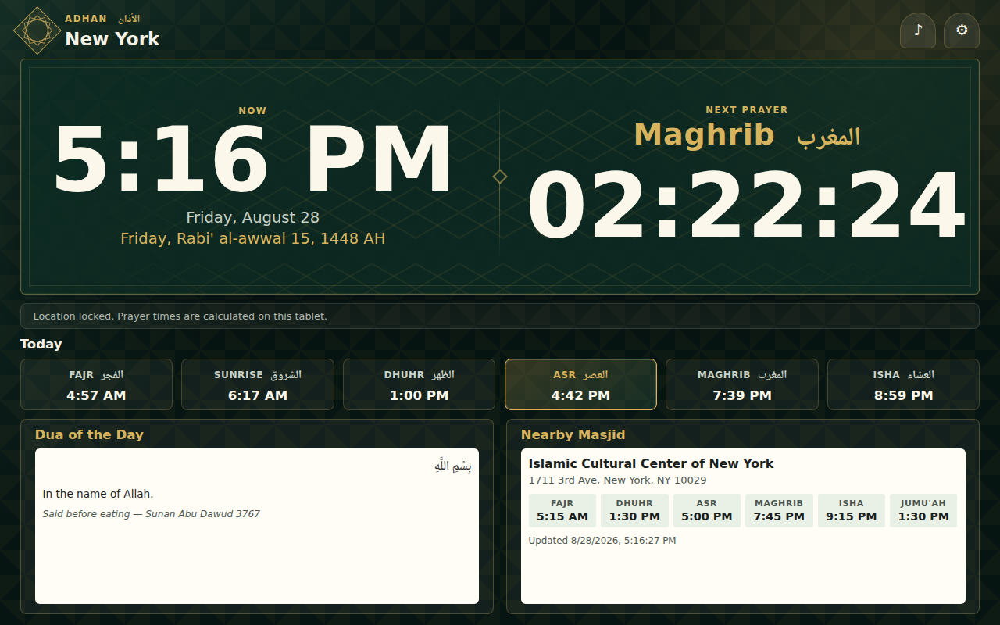

# Adhan

Static tablet kiosk web app for Islamic prayer times.



## Features

- Uses browser geolocation to calculate local prayer times entirely on-device — no external prayer-times API.
- Current time and the countdown to the next prayer are the primary display, with a compact strip of today's six prayer times below.
- Automatic light/dark theme based on time of day (light 6am–7pm, dark otherwise), with no flash on load.
- Shows both the Gregorian date and the Hijri (Islamic) date.
- Shows each prayer's Arabic name next to the English, set in Noto Naskh Arabic.
- Plays a selectable adhan recording at Fajr, Dhuhr, Asr, Maghrib, and Isha when audio is enabled, with per-prayer on/off toggles and a play/stop preview button for each reciter in Settings.
- Falls back to browser speech synthesis if the remote adhan audio is unavailable.
- Rotates a "Dua of the Day" from a built-in collection of 100 short azkar/duas (Arabic with diacritics + English translation). Off the screen by default — enable it in Settings.
- Shows the next three major Islamic occasions (Ramadan, the two Eids, Hajj/Arafah, Muharram/Ashura, Isra & Mi'raj, Islamic New Year) with Hijri date, Gregorian date, and a day countdown — computed on-device from the Umm al-Qura calendar. Also off by default; enable it in Settings.
- Looks up the closest masjid to your location and its iqama times using the Claude API (with web search), refreshed daily.
- Stores all preferences (calculation method, reciters, audio toggles, API key) in `localStorage` — no database.
- Optional "Random from YouTube" adhan: a small yt-dlp service (`yt/server.py`) picks a random popular adhan video and plays its audio, with a separate pool of Fajr adhans.

## Local run

Open `index.html` directly, or serve it (recommended, since geolocation requires HTTPS or localhost):

```sh
python3 -m http.server 8080
```

or via the production container:

```sh
docker build -t adhan .
docker run --rm -p 8080:80 adhan
```

## Settings

Tap ⚙ to open Settings, where you can change the prayer-time calculation method, choose from 17 Sunni adhan recordings (from [praytimes.org](https://praytimes.org/docs/adhan)), preview any reciter with the ▶/■ buttons next to each dropdown, toggle which of the five daily prayers play an adhan, set a Claude API key for the nearby-masjid lookup, and show or hide the Dua of the Day and Upcoming Islamic Dates sections (both off by default, to keep the main screen focused on the clock and countdown). Browser autoplay policies require tapping the ♪ audio button once after the kiosk page loads before any adhan can play automatically.

## Dua of the day

`azkar.js` holds 100 short azkar/duas drawn from the Qur'an and authentic hadith collections (Bukhari, Muslim, Abu Dawud, Tirmidhi, Ibn Majah — the same corpus compiled in *Hisn al-Muslim*), each with Arabic (with diacritics), an English translation, and a source reference. The app picks one deterministically by day-of-year, so it stays the same all day and rotates at local midnight. Edit `azkar.js` to add, remove, or correct entries — worth a scholar's review before relying on it for public display.

## Nearby masjid lookup

In Settings, enter a Claude API key (stored only in `localStorage`, never sent anywhere but `api.anthropic.com`). Once set and geolocation succeeds, the app asks Claude (with web search) to find the closest masjid and its iqama times, caching the result and refreshing once every 24 hours.

## YouTube adhan service

Choosing **Random from YouTube** in either reciter dropdown plays a random popular adhan from YouTube instead of a fixed recording. `yt/server.py` (standard-library Python plus [yt-dlp](https://github.com/yt-dlp/yt-dlp)) searches YouTube once a day, keeps 8 audio-only downloads per pool (videos 1–10 minutes long with ≥250k views, minus live streams, hour-long loops, compilations and similar), and serves them at `/yt/`. Fajr has its own pool. If the service is unavailable, the default reciter plays instead. `GET /yt/status` lists what's currently in each pool.

Run everything locally:

```sh
python3 -m venv .venv && .venv/bin/pip install "yt-dlp[default]" deno
STATIC_DIR=. DATA_DIR=/tmp/adhan-yt .venv/bin/python yt/server.py   # http://localhost:8080
```

In k8s it's the `adhan-yt` Deployment and Service (`k8s/yt-*.yaml`), routed at `/yt`. Tunables, as env vars: `POOL_SIZE`, `MIN_VIEWS`, `REFRESH_HOURS`.

## Android app

`android/` is a [Capacitor](https://capacitorjs.com) shell for sideloading onto tablets. It does **not** bundle a copy of the web app: it loads the live site (`server.url` in `capacitor.config.json`), so every web deploy reaches the Android app automatically, with no rebuild or reinstall. Cloudflare's edge cache applies to the app too. `android-www/offline.html` is the only bundled page, shown while the site is unreachable.

The app adds what a browser tab can't do: it keeps the screen on, runs fullscreen, autoplays the adhan without a tap, and, when the app is backgrounded or the screen locks, schedules native notifications for the next 7 days of adhans (sound: the bundled `android/app/src/main/res/raw/adhan.mp3` / `adhan_fajr.mp3`). These are cancelled on resume so the in-app reciter plays instead. That logic lives in `app.js` behind the `nativeApp` guard, and is a no-op in browsers.

Build (needs Node, JDK 21 and the Android SDK with `ANDROID_HOME` set):

```sh
npm install
npm run apk
adb install -r android/app/build/outputs/apk/debug/app-debug.apk
```

Only native changes (`android/`, `capacitor.config.json`, plugins) need a new APK.
